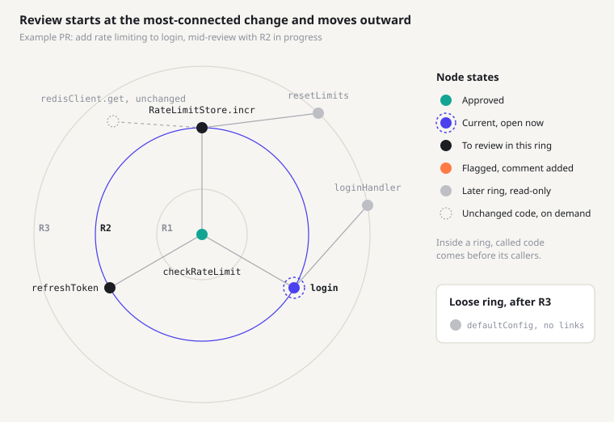

# NitOwl Vision: Ring-Based Review

_As of 2026-10-15_

## The idea

NitOwl reviews a pull request as a graph of changed functions: start at the most-connected change,
then work outward one ring at a time, and finish with one GitHub review.

GitHub lists a diff in filename order, not in the order the code makes sense. Reviewers read a
caller before the function it calls, or miss that three files change one behavior. NitOwl reorders
the diff by how the changed code connects, so the heart of the change comes first and the edges
come last.

Pitch: **review the heart of the change first, then work outward.**

## Core concepts

A chunk is the unit you review; everything else describes how chunks are grouped and ordered.

| Term          | What it is                                                                                                                                                                                      |
| ------------- | ----------------------------------------------------------------------------------------------------------------------------------------------------------------------------------------------- |
| Chunk         | One changed function or method, holding every diff hunk inside it. Hunks outside any function (imports, top-level constants) group into one chunk per file. Each chunk is one dot on the graph. |
| Edge          | A call or reference between two chunks, taken from the graphify graph.                                                                                                                          |
| Indirect edge | An edge through exactly one unchanged function: changed `A` calls unchanged `B`, which calls changed `C`, so `A` links to `C`.                                                                  |
| Score         | How central a chunk is: links to other changed chunks × log(lines changed + 1).                                                                                                                 |
| Cluster       | A group of chunks connected to each other. A PR with unrelated changes has several.                                                                                                             |
| Center        | The highest-scoring chunk in each cluster. All centers make up R1.                                                                                                                              |
| Ring          | R1 is the centers. R2 is everything one hop from any center, R3 two hops, and so on.                                                                                                            |
| Loose ring    | Chunks with no links to other changed code, reviewed last.                                                                                                                                      |
| Ghost node    | Unchanged code shown on demand for context. Never reviewed, never counted.                                                                                                                      |

## How rings are built

Rings come from graph distance: one search outward from every center at once, run on a graph of
only the PR's changed chunks.

1. **Build the code graph.** Run graphify on the PR's head commit. graphify works at the file level
   today, so it needs symbol-level nodes (functions and methods, with line ranges) to support
   chunks.
2. **Map hunks to chunks.** Assign each diff hunk to the smallest function that contains it. Hunks
   outside any function go to that file's chunk.
3. **Build the PR graph.** Keep only chunks and the edges between them. Add an indirect edge when
   two changed chunks are linked through exactly one unchanged function. Ignore direction here, but
   keep it for step 8.
4. **Score every chunk.** Score = links to other changed chunks × log(lines changed + 1). A helper
   called everywhere scores low unless its callers also changed.
5. **Pick centers.** For every cluster of two or more chunks, the top scorer is its center. Break
   ties by lines changed, then by file path, so the same PR always gives the same rings.
6. **Assign rings.** Search outward from all centers together. A chunk's ring = its distance to the
   nearest center + 1.
7. **Collect the loose ring.** Chunks with no links at all go into a final Loose ring.
8. **Order each ring callees-first.** Inside a ring, code that is called comes before the code that
   calls it. Where calls form a loop, the higher score goes first.

Proposed default to tune once real PRs run through it: rings past R4 merge into one **R4+** ring,
because outer rings tend to get thin.

## The review experience

You work R1 first, then each ring outward. Later rings stay open for reading but can't be approved
until their turn.

1. **Pick a PR from the inbox.** NitOwl builds the rings and opens R1.
2. **Review chunks in order.** The first chunk in the ring is Current. Others in the ring are
   Active. Order is callees-first.
3. **Approve or flag each chunk.** Flagging adds a comment on that chunk's lines. It doesn't block
   the ring.
4. **Finish the ring.** When every chunk is approved or flagged, the ring turns done and the next
   ring unlocks.
5. **Repeat through the outer rings and the Loose ring,** then submit (see
   [Submitting to GitHub](#submitting-to-github)).

**Soft lock.** A later ring shows its chunks greyed out as Locked. You can open any of them
read-only, but Approve and Flag only work in the current ring.

**Peeking at unchanged code.** Expand any chunk to show the unchanged functions it calls or is
called by as ghost nodes. Click one to read its code. Ghost nodes are never reviewed or counted,
and they disappear when you collapse the chunk.

## What it looks like

The screen has three parts: ring tabs across the top (R1, R2, R3, Loose, each with its chunk
count), the ring graph, and a code panel for the current chunk with Approve and Flag.

In this example, R1 (`checkRateLimit`) is approved and R2 is in progress with `login` open. R3 can
be read but not approved yet. The ghost node shows unchanged `redisClient.get` for context.

## Submitting to GitHub

When the last ring is done, NitOwl sends one GitHub review: **Approve** if nothing was flagged,
**Request changes** if anything was.

- Each flag becomes an inline comment on the lines of its chunk.
- Nothing is posted before you submit, so flags and progress stay local until then.
- After you submit, the PR leaves your inbox until the author pushes again or asks you to review
  again.

## Decisions and open questions

Eight product decisions are settled; seven questions are still open.

| Question                      | Decision                                                                        | Why                                                           |
| ----------------------------- | ------------------------------------------------------------------------------- | ------------------------------------------------------------- |
| What sits at the center?      | The most-connected changed chunk, ignoring direction, weighted by lines changed | Predictable, and it keeps busy helpers like loggers out of R1 |
| Unrelated clusters in one PR? | One shared ring set: R1 holds every cluster's center                            | Keeps one line of ring tabs and the existing locking flow     |
| What is one dot?              | A changed function (a chunk)                                                    | A function edited in three places stays one thing to review   |
| How strict is gating?         | Soft lock: later rings are read-only until their turn                           | Guides the order without trapping the reviewer                |
| Order inside a ring?          | Callees first                                                                   | You see the building blocks before the code that uses them    |
| What does a flag do?          | Adds a comment; the ring can still finish                                       | Problems are recorded without stalling the review             |
| How does unchanged code show? | Ghost nodes, on demand                                                          | Context when you want it, a clean graph when you don't        |
| What goes to GitHub?          | One review at the end                                                           | One notification for the author, with a clear verdict         |

**Open questions**

- [ ] **Ring cap.** Should rings past R4 merge into one R4+ ring, or should every ring show
      separately?
- [ ] **New pushes mid-review.** Rebuild the rings and keep approvals on chunks whose code didn't
      change?
- [ ] **Deleted functions.** They aren't in the head graph. Place them using the base commit's
      graph?
- [ ] **Tests.** Should test functions that call changed code join their cluster, or go to the
      Loose ring?
- [ ] **Very large PRs.** Is there a chunk count above which NitOwl splits a ring or warns the
      reviewer?
- [ ] **Direction toggle.** Add a bottom-up / top-down option for scoring later?
- [ ] **Separate ring sets per cluster.** Revisit if a mixed R1 confuses people in practice.

## Non-goals for v1

- Reviewing unchanged code. Ghost nodes are for reading only.
- Replacing GitHub's conversation threads. Discussion after the review stays on GitHub.
- Hard locks that stop reviewers from reading ahead.
- A separate ring set for each cluster.
